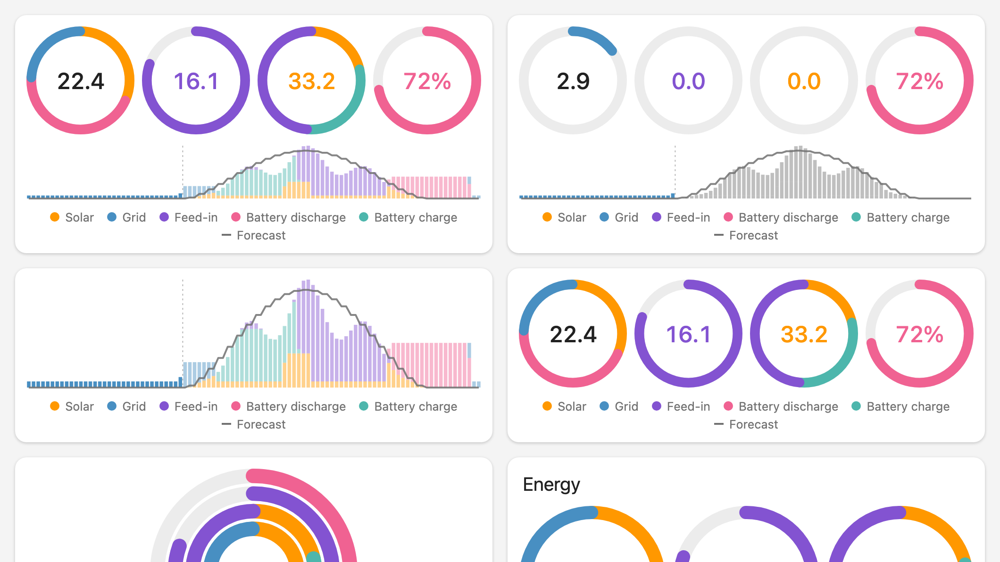
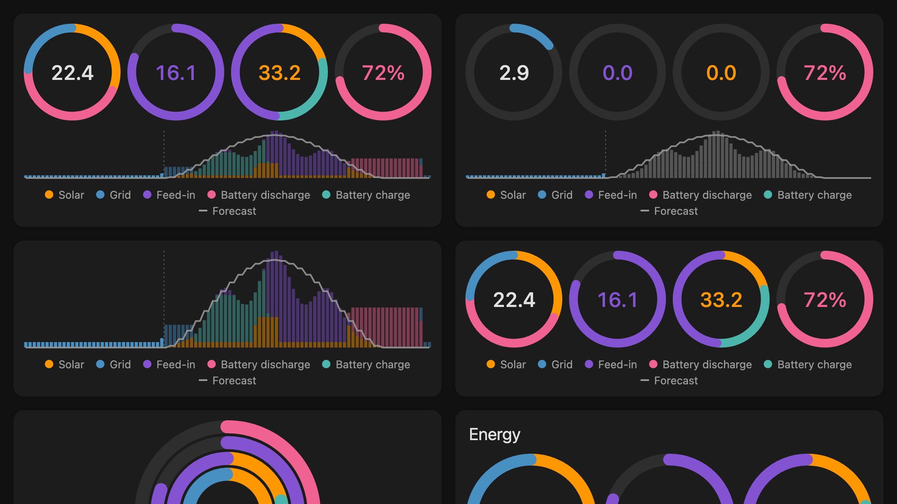

# HA Energy Widget

A Home Assistant dashboard card that shows the energy flows of your house for the last 24 hours:
four rings (consumption mix, grid feed-in, production mix, battery level) and a stacked timeline in
15-minute steps with the solar forecast as a gray line.

It is the Home Assistant counterpart of [aharren/ios-energy-widget](https://github.com/aharren/ios-energy-widget),
an iOS widget (Scriptable.app) by Arne Harren. The visual concept, the four styles and the `style` / `time-range`
options come from there; this card is a new implementation that reads Home Assistant's own long-term statistics
instead of Grafana/InfluxDB.

| Light | Dark |
| --- | --- |
|  |  |

The screenshots show the dev page with synthetic demo data.

## Installation

### HACS (recommended)

1. In HACS open the menu (three dots) → **Custom repositories**.
2. Add `https://github.com/andre68723/ha-energy-widget` with the type **Dashboard**.
3. Search for **HA Energy Widget** in HACS, open it and choose **Download**.
4. Reload the browser page (or restart the Home Assistant app on a phone). HACS registers the resource
   `/hacsfiles/ha-energy-widget/ha-energy-widget.js` for you.

HACS installs the file attached to the latest [GitHub release](https://github.com/andre68723/ha-energy-widget/releases).

### Manual

1. Download `ha-energy-widget.js` from the latest release and copy it to `config/www/`.
2. Add it as a resource: **Settings → Dashboards → ⋮ → Resources → Add resource**,
   URL `/local/ha-energy-widget.js`, type **JavaScript module**.
3. Reload the browser page.

### Add the card

Open a dashboard in edit mode, choose **Add card** and pick **Energy Widget**, or use YAML:

```yaml
type: custom:ha-energy-widget
```

Without further options the card uses the sources of your **Energy dashboard** (Settings → Dashboards → Energy),
including all solar inverters, batteries and the solar forecast. The only value it cannot find there is the
battery level; add it under `entities.battery_level`.

## Configuration

| Option | Default | Description |
| --- | --- | --- |
| `layout` | `rings_timeline` | `rings_timeline` (iOS style 1), `rings` (style 2), `timeline` (style 3), `nested_rings` (style 4) |
| `time_range` | `last_24h` | `last_24h` or `today`; see below |
| `title` | none | Card title |
| `forecast` | `true` | Draw the solar forecast of the Energy dashboard as a gray line |
| `legend` | `true` | Show a legend with the colors of solar, battery, grid and feed-in below the card |
| `entities` | Energy dashboard | Energy meters per channel, see below |
| `max` | see below | Scale of the rings and the timeline in kWh |
| `colors` | Energy dashboard colors | Any CSS color per role |
| `tap_action` | navigate to `/energy` | `navigate`, `url`, `more-info` or `none` |

### Time range

* `last_24h`: the timeline starts at 0:00 today. Up to now it shows today; for the rest of the day it shows the
  same time yesterday, faded. The rings sum the last 24 hours.
* `today`: the rings sum the day since 0:00; after now, the timeline shows only yesterday's production in gray.

### Entities

Each channel takes one entity or a list (their energy is summed, e.g. two inverters). A channel that is not
configured falls back to the Energy dashboard. Use cumulative energy sensors that have long-term statistics
(`state_class: total` or `total_increasing`); Wh and MWh are converted to kWh by Home Assistant.

```yaml
type: custom:ha-energy-widget
layout: rings_timeline
time_range: last_24h
entities:
  solar: [sensor.inverter_1_energy, sensor.inverter_2_energy]
  grid_import: sensor.grid_import
  grid_export: sensor.grid_export
  battery_charge: sensor.battery_charge
  battery_discharge: sensor.battery_discharge
  battery_level: sensor.battery_level   # percent, shown live
max:
  consumption: 25    # kWh that fill the consumption ring
  production: 40
  feed: 30
  interval: 1.5      # kWh per 15 minutes that fill the timeline height
colors:
  solar: "#ffd60a"
```

Battery charge and discharge belong together: with only one of them the battery is left out.

### Scale

A ring is full at its `max` value (defaults: 20 kWh each). A larger sum grows the ring's scale, so a ring never
overflows. The timeline height is `max.interval` kWh per quarter hour (default 1.5) and grows the same way.

## How it works

* Data: `recorder/statistics_during_period` with five-minute periods and the `change` type, summed into
  96 quarter-hour slots. A slot with no data stays a gap, never a zero bar. The card refreshes shortly after each
  five-minute boundary while the page is visible.
* Forecast: `energy/solar_forecast`, the call the Energy dashboard uses (Forecast.Solar, Solcast, Open-Meteo, …).
  Values are taken as the energy of the period that starts at their timestamp, as the Energy dashboard does.
* Mix: the rings split consumption into solar, battery and grid. Aggregate meters cannot tell whether grid energy
  went into the battery or the house when both happen in the same quarter hour, so the split is **estimated**:
  grid serves the house first and then the battery; solar serves the rest of the house, then the battery, then
  feeds in; the battery covers what is left. Measured meter values are never altered.
* Statistics for five-minute periods are kept for 10 days by default (`purge_keep_days`), which is enough for 24 hours.

## Development

Requires Node.js 22 or newer.

```sh
npm ci
npm run dev        # http://127.0.0.1:5173/dev/index.html with a synthetic Home Assistant
npm run check      # typecheck, lint, tests, production build
```

`dist/ha-energy-widget.js` is the single file Home Assistant loads. See [AGENTS.md](AGENTS.md) for the layout of
the source, the checks and the release process.

## Credits and license

MIT, see [LICENSE](LICENSE). The visual concept and the widget options come from
[aharren/ios-energy-widget](https://github.com/aharren/ios-energy-widget) (MIT, Copyright (c) 2021 Arne Harren).
The mix rules are shared with the energy timeline of the BETTA HA Panel firmware.
